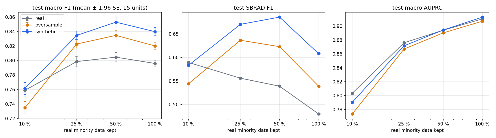
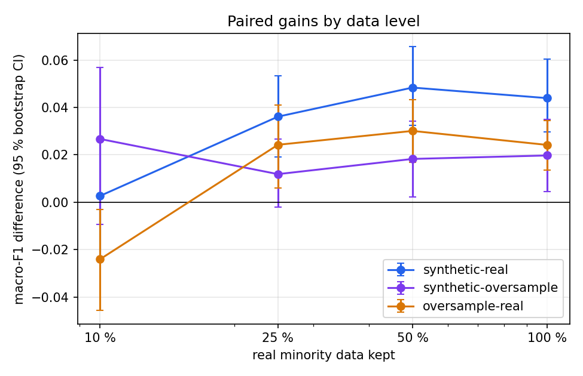
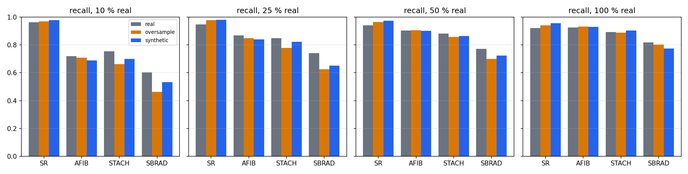

# Study 3 results: does synthetic data help more when real data is scarce? (2026-10-30)

- Registration: `report/PREREGISTRATION_3.md` (commit 696ffa9).
- Analysis: `_study3_analysis.py`, frozen at registration and run **once** on 2026-10-30.
- Raw output: `generator_comparison/experiment/study3/study3_result.md` / `.json` and `figures/`.
- Everything in §1–§4 is the registered analysis. §5 is post hoc reading and is labelled as such.

## 1. Design in one paragraph
- Each minority class (AFIB, STACH, SBRAD) of the PTB-XL training set was cut to **10, 25, 50 or 100 %** of its
  patients. There were 3 random draws per level; SR was kept whole.
- Below 100 %, a fresh beat-template generator was trained on each subset (9 generators). This keeps the generator
  from seeing the dropped patients.
- Three training conditions per subset:
  - **real:** class-weighted, nothing added.
  - **oversample:** real minority ECGs duplicated up to 2× the full-data count.
  - **synthetic:** filled up to the same count from that subset's own generator, picked at random.
- Each condition was trained with 5 seeds, giving 4 × 3 × 5 × 3 = **180 runs**.
- Unit of analysis: (draw, seed), 15 per level. Metric: test macro-F1.

## 2. Integrity audit (before the analysis was run)

| check | result |
|---|---|
| runs complete | **180 / 180**, one attempt (`experiment_study3_run.log`: a single "attempt 1"), no resume |
| training length | every run 6,250 steps with 25 validation evaluations |
| registered hashes | **40 / 40 match**: 3 subsets, 12 pools, 9 generators, 9 assembly models, 4 scripts, checks, gate |
| config hashes | every cell's `config.json` pool and subset sha256 match the files on disk |
| condition sanity | `n_synthetic > 0` exactly for the synthetic condition |
| reproducibility of metrics | test and validation macro-F1 recomputed from saved probabilities: max abs. difference 2.2e-16 |
| frozen study 1–2 artifacts | unchanged (`_study3_common.check_frozen`) |
| pools (Phase 2) | `_check_study3.py` ALL PASS; gate GO (G1 all levels > 0.35, G2 max copy 0.0018, G3 identical) |

## 3. Results

### 3.1 Test macro-F1 (mean ± SD over 15 units)

| real minority kept | real | oversample | synthetic |
|---|---|---|---|
| 10 % | 0.7588 ± 0.0176 | 0.7348 ± 0.0172 | **0.7615** ± 0.0162 |
| 25 % | 0.7986 ± 0.0146 | 0.8228 ± 0.0112 | **0.8347** ± 0.0117 |
| 50 % | 0.8047 ± 0.0127 | 0.8348 ± 0.0129 | **0.8530** ± 0.0138 |
| 100 % | 0.7960 ± 0.0090 | 0.8201 ± 0.0104 | **0.8399** ± 0.0110 |

### 3.2 Registered hypotheses

| | comparison | mean diff | wins | dz | p | adj. p | 95 % CI (3-level bootstrap) | decision |
|---|---|---|---|---|---|---|---|---|
| **H1** (primary) | synthetic − real at 10 % | +0.0027 | 9/15 | 0.11 | 0.600 | 0.600 (single test) | −0.024 to +0.027 | **NOT SUPPORTED** |
| H2-10 | synthetic − oversample, 10 % | +0.0267 | 11/15 | 0.97 | 0.0043 | 0.013 | −0.009 to +0.057 | SUPPORTED |
| H2-25 | synthetic − oversample, 25 % | +0.0119 | 12/15 | 0.96 | 0.0034 | 0.013 | −0.002 to +0.027 | SUPPORTED |
| H2-50 | synthetic − oversample, 50 % | +0.0183 | 13/15 | 0.99 | 0.0020 | 0.010 | +0.002 to +0.034 | SUPPORTED |
| H2-100 | synthetic − oversample, 100 % | +0.0197 | 13/15 | 1.27 | 0.00043 | 0.0026 | +0.005 to +0.035 | SUPPORTED |
| H3 | synthetic − oversample gain grows as data falls | | | | 0.536 (L = 374) | 1 | | **NOT SUPPORTED** |
| H4 | synthetic − real gain grows as data falls | | | | 1.000 (L = 330) | 1 | | **NOT SUPPORTED** |

Holm runs over H2-10/25/50/100, H3 and H4. Decisions follow the registered rule: adjusted Wilcoxon p < 0.05 with a
positive mean.

**Uncertainty caveat, stated in the registration (§7).** Seeds within a draw share the subset and the generator, so
the 15-unit Wilcoxon is optimistic. The honest uncertainty is in the bootstrap CI, which resamples draws, and in the
draw-level t-test (df = 2).
- **H2-10:** one of the three draws went the other way (draw means −0.006, +0.050, +0.036). The bootstrap CI
  includes 0 and the draw-level p is 0.26. It is "supported" by the registered rule but **not robust**.
- **H2-25:** CI −0.002 to +0.027, draw-level p 0.040. Borderline.
- **H2-50 and H2-100:** the CIs exclude 0 and every draw is positive. Robust.

### 3.3 Consistency with study 2 (the 100 % cells repeat its recipe)

| condition | study 3, 100 % | study 2 | difference |
|---|---|---|---|
| real | 0.7960 | 0.8030 | −0.0070 |
| oversample | 0.8201 | 0.8199 | +0.0002 |
| synthetic | 0.8399 | 0.8393 | +0.0006 |

oversample and synthetic reproduce to within 0.001. real is 0.007 lower, within its seed-to-seed SD (0.009); the
study 2 numbers came from different seeds. No sign of a pipeline bug.

### 3.4 Descriptive: per-class and threshold-free metrics

| level | condition | F1 SR / AFIB / STACH / SBRAD | recall SBRAD | SBRAD AUPRC | macro AUPRC |
|---|---|---|---|---|---|
| 10 % | real | 0.961 / 0.757 / 0.727 / 0.589 | 0.60 | 0.609 | **0.803** |
| 10 % | oversample | 0.958 / 0.732 / 0.704 / 0.544 | 0.46 | 0.554 | 0.773 |
| 10 % | synthetic | 0.964 / 0.762 / 0.736 / 0.583 | 0.53 | 0.583 | 0.790 |
| 25 % | real | 0.962 / 0.862 / 0.815 / 0.556 | 0.74 | 0.702 | **0.876** |
| 25 % | oversample | 0.973 / 0.869 / 0.813 / 0.637 | 0.62 | 0.670 | 0.867 |
| 25 % | synthetic | 0.976 / 0.866 / 0.827 / 0.670 | 0.65 | 0.701 | 0.872 |
| 50 % | real | 0.961 / 0.882 / 0.837 / 0.539 | 0.77 | 0.726 | **0.894** |
| 50 % | oversample | 0.972 / 0.892 / 0.852 / 0.623 | 0.70 | 0.708 | 0.890 |
| 50 % | synthetic | 0.977 / 0.893 / 0.856 / 0.686 | 0.72 | 0.719 | **0.894** |
| 100 % | real | 0.953 / 0.893 / 0.858 / 0.480 | 0.82 | 0.758 | 0.910 |
| 100 % | oversample | 0.963 / 0.905 / 0.873 / 0.539 | 0.80 | 0.749 | 0.907 |
| 100 % | synthetic | 0.971 / 0.905 / 0.875 / 0.608 | 0.77 | 0.763 | **0.913** |

## 4. Answers to the registered questions
1. **H1: does synthetic data beat real-only training when only 10 % of the minority data is left? No.** The
   difference is +0.003 (CI −0.024 to +0.027), and draws disagree in sign.
2. **H2: does synthetic data beat duplicating real ECGs? Yes at every level** by the registered test (+0.012 to
   +0.027). The evidence is robust at 50 % and 100 % and weak at 10 %.
3. **H3/H4: does the benefit grow as real data gets scarcer? No.** Neither the gain over oversampling (p = 0.54) nor
   the gain over real-only (p = 1.0) rises toward 10 %. The gain over real-only goes the *other* way: +0.044 / +0.048 /
   +0.036 / +0.003 from 100 % down to 10 %.

**One-sentence result:** synthetic data from this generator helps when there is a moderate amount of real minority
data (25–100 %, +0.036 to +0.048 macro-F1 over real-only, 14–15 of 15 wins) and gives no measurable gain at 10 %. The
common claim that synthetic augmentation matters *most* when data is scarce is **not supported** here.

## 5. Post hoc reading (looked at after the registered analysis; exploratory)
- **The gain is mostly a threshold effect, as in study 2.** Macro AUPRC (threshold-free) is essentially equal across
  conditions at every level: synthetic − real is −0.013, −0.004, 0.000 and +0.003. Synthetic data shifts the
  operating point, with higher minority precision and F1 at similar or lower recall. It does not make the classifier
  rank cases better.
- **At 10 % the generator probably has too little to learn from.** SBRAD has about 45 training templates. The gate's
  train-on-synthetic balanced accuracy was lowest at 10 % (0.46–0.59, against 0.73–0.75 at 100 %). A weaker generator
  plausibly explains why the gain over real-only vanishes there. This cannot be separated from the effect of class
  weighting (next point).
- **Real-only training with extreme class weights is a strong baseline at 10 %.** It weights SBRAD about 66×, and it
  has the best SBRAD recall and AUPRC at 10 %. Oversampling at 10 % is *worse* than real-only (−0.024, 2/15 wins):
  duplicating about 45 SBRAD ECGs 20× overfits.
- **real is not monotone in data.** Its macro-F1 at 100 % (0.796) is below 50 % (0.805), and its SBRAD F1 falls from
  0.59 to 0.48 as data grows, while SBRAD recall rises from 0.60 to 0.82. More real SBRAD data with class weighting
  pushes the classifier toward over-calling SBRAD (lower precision). Macro-F1 differences in this study partly reflect
  the operating point, consistent with the first point.
- **Correction (2026-10-30, code review): class weights do not change the class balance of the loss.** With
  w_c = n / (4 n_c), every class contributes exactly a quarter of the expected loss in every condition, because
  frequency × weight = n_c/n × n/(4 n_c). The registration's reason for expecting H4 ("real-only weights SBRAD about
  66×") holds per ECG, but those ECGs are 66× rarer. Real-only and the filled conditions differ in gradient noise and
  overfitting to few, heavily weighted minority ECGs, not in how much each class counts overall.
- **Note (2026-10-30, code review, validation and train only): the SBRAD labels follow about 50 bpm, not 60.**
  Heart rate from the project estimator (QRS-envelope peaks, kept where they agree with the autocorrelation rate
  within 15 %):

  | | validation | train sample (3,000) |
  |---|---|---|
  | ECGs labelled SR with HR < 60 bpm | 16.7 % | 15.4 % |
  | median HR of those SR ECGs / of SBRAD | 56 / 49 bpm | 56 / 49 bpm |
  | SBRAD F1 of the rule "HR < 60 → SBRAD" | 0.31 | 0.29 |
  | SBRAD F1 of the rule "HR < 50 → SBRAD" | 0.76 | 0.79 |

  At 100 %, validation SBRAD F1 is 0.48 (real), 0.51 (oversample) and 0.58 (synthetic). The rule is scored on SR and
  SBRAD ECGs only, so it is a rough reference. SR → SBRAD errors of the real-only runs have a median HR of 54 bpm.
  This is consistent with the flat SBRAD AUPRC: the classifier is limited by how well it reads heart rate and by
  where annotators draw the line, more than by the amount of minority data.
- **Implication for study 4 and beyond.** Gains in this setup come from where the decision threshold lands, not from
  better separation. A threshold-tuned real-only baseline (tuned on validation) is the natural next control. It was
  not registered here.

## 6. Limitations (from the registration, unchanged)
- The PTB-XL test split was reused (4th analysis on it).
- Seeds within a draw are not independent (see the §3.2 caveat).
- One generator serves all 100 % draws.
- One classifier, one generator family, one dataset.
- The 10 % SBRAD generator learns from about 45 templates; memorisation was checked (max copy fraction 0.0018) but
  cannot be fully excluded.
